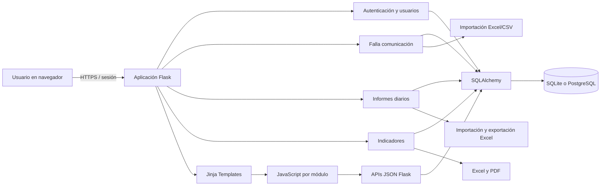
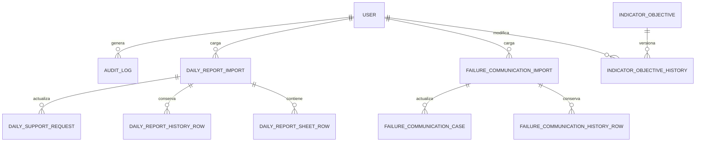
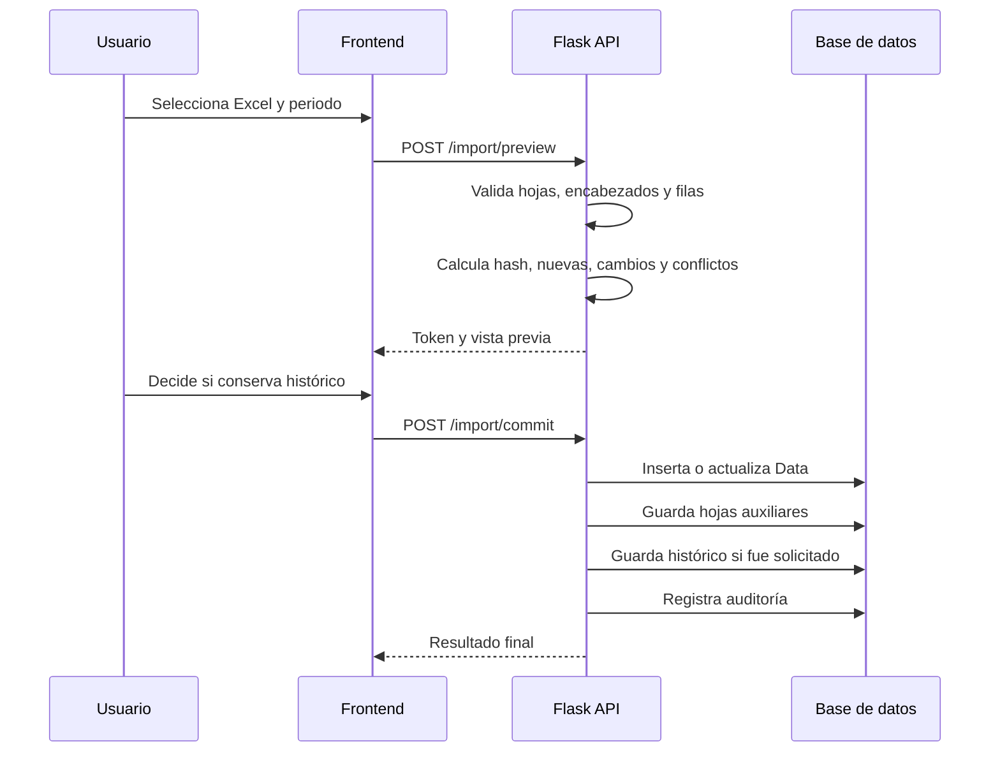
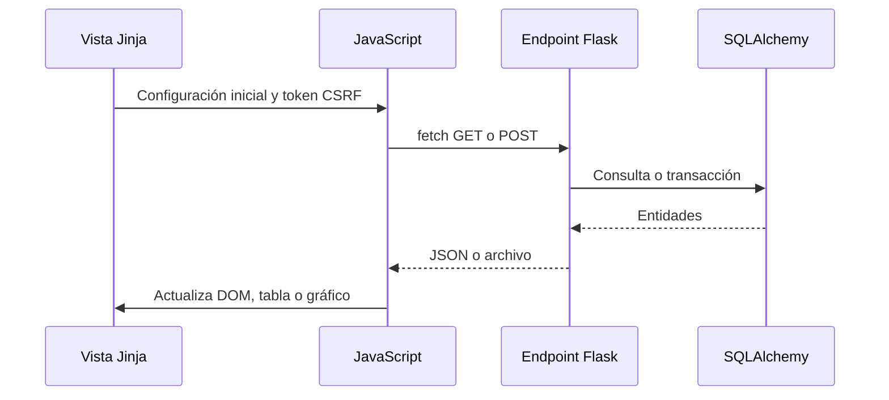

# Informe técnico de arquitectura

## Sistema de gestión de mesa de soporte

**Fecha de revisión:** 4 de octubre de 2026  
**Alcance:** código fuente actual del backend, frontend, modelo de datos, seguridad, importaciones, exportaciones y operación local.

---

## 1. Resumen ejecutivo

La aplicación está construida como un **monolito modular en Flask**. El servidor entrega páginas HTML renderizadas con Jinja y también expone APIs JSON que alimentan tableros interactivos. Cada módulo funcional tiene su propio archivo Python, plantilla, estilos y JavaScript.

La solución cubre actualmente cuatro áreas principales:

1. **Autenticación y administración de usuarios.**
2. **Falla comunicación**, con carga de archivos y análisis operativo.
3. **Informes diarios**, con carga validada de libros Excel, métricas, filtros, gráficos, históricos y exportación.
4. **Indicadores**, con objetivos, metas, valores mensuales, alertas, histórico y exportaciones administrativas.

La persistencia utiliza **SQLAlchemy**. Por defecto se emplea SQLite para desarrollo y puede utilizarse PostgreSQL mediante `DATABASE_URL`. La aplicación usa sesiones de Flask, Flask-Login, protección CSRF y contraseñas cifradas con Bcrypt.

El frontend no es una SPA. Se apoya en:

- HTML generado en el servidor.
- CSS propio por módulo.
- JavaScript sin framework.
- `fetch` para consultar y actualizar datos.
- Chart.js para gráficos.
- OpenPyXL y ReportLab en el servidor para exportaciones.
- Bibliotecas de navegador adicionales en Falla comunicación para capturas y reportes.

---

## 2. Vista general de la arquitectura



### Patrón principal

La aplicación sigue una variante sencilla de **MVC**:

- **Modelo:** clases SQLAlchemy en `app/models.py`.
- **Controladores:** rutas Flask organizadas en Blueprints.
- **Vista:** plantillas Jinja en `templates/`.
- **Interactividad:** archivos JavaScript en `static/js/`.

No existe una capa de servicios independiente. La mayoría de las reglas de negocio, consultas y serialización están dentro de los archivos de cada Blueprint.

---

## 3. Tecnologías y dependencias

### Backend

| Componente | Uso |
|---|---|
| Python 3.11 o superior | Lenguaje principal |
| Flask 3 | Servidor web y enrutamiento |
| Flask-SQLAlchemy | ORM y conexión con la base de datos |
| Flask-Login | Sesiones y autenticación |
| Flask-WTF | Protección CSRF |
| Flask-Bcrypt | Hash seguro de contraseñas |
| python-dotenv | Lectura de variables desde `.env` |
| pandas | Lectura, normalización y análisis de hojas |
| OpenPyXL | Lectura y creación de archivos Excel |
| xlrd | Compatibilidad con hojas antiguas en algunos flujos |
| ReportLab | Generación de reportes PDF de indicadores |
| psycopg | Conexión con PostgreSQL |
| Gunicorn | Servidor WSGI recomendado para producción |

### Frontend

| Componente | Uso |
|---|---|
| Jinja | Renderizado HTML en el servidor |
| JavaScript nativo | Filtros, consultas, formularios, tablas y actualización dinámica |
| CSS propio | Diseño general y estilos por módulo |
| Chart.js | Gráficos operativos |
| Tailwind por CDN | Parte del diseño de Falla comunicación |
| SheetJS por CDN | Exportaciones Excel del navegador en Falla comunicación |
| html2canvas | Captura visual de reportes |
| jsPDF | Exportación PDF desde el navegador en Falla comunicación |

---

## 4. Estructura del proyecto

```text
Sistema de gestion mesa/
├── app/
│   ├── __init__.py               Fábrica de la aplicación y seguridad global
│   ├── auth.py                   Login, contraseñas y usuarios
│   ├── cli.py                    Inicialización y migraciones compatibles
│   ├── dashboard.py              Página de inicio
│   ├── daily_reports.py          Informes diarios e importaciones Excel
│   ├── falla_comunicacion.py     Módulo Falla comunicación
│   ├── indicators.py             Objetivos e indicadores
│   └── models.py                 Modelo relacional
├── templates/
│   ├── base.html                 Estructura visual común
│   ├── dashboard.html
│   ├── login.html
│   ├── users.html
│   ├── user_detail.html
│   ├── change_password.html
│   ├── partials/
│   │   └── confirm_modal.html
│   └── modules/
│       ├── daily_reports.html
│       ├── falla_comunicacion.html
│       ├── indicators.html
│       ├── indicator_objectives_menu.html
│       ├── indicator_objectives.html
│       └── indicator_objectives_edit.html
├── static/
│   ├── css/                      Estilos generales y por módulo
│   └── js/                       Lógica general y por módulo
├── config.py                     Configuración por entorno
├── run.py                        Punto de entrada
├── requirements.txt              Dependencias Python
└── README.md                     Guía de instalación y operación
```

---

## 5. Arranque y configuración

### Punto de entrada

`run.py` crea la aplicación mediante `create_app()` y registra dos comandos:

- `flask --app run.py init-db`
- `flask --app run.py create-admin`

En ejecución directa usa `debug=False`.

### Fábrica de aplicación

`app/__init__.py` realiza estas tareas:

1. Crea la instancia Flask.
2. Carga la clase `Config`.
3. Rechaza el inicio si `SECRET_KEY` no existe o tiene menos de 32 caracteres.
4. Crea el directorio de cargas.
5. Inicializa SQLAlchemy, Bcrypt, CSRF y LoginManager.
6. Registra los Blueprints.
7. Obliga a cambiar una contraseña temporal antes de acceder al resto del sistema.
8. Añade cabeceras HTTP de seguridad y políticas de caché.

### Variables de entorno principales

| Variable | Propósito |
|---|---|
| `SECRET_KEY` | Firma de sesión y tokens CSRF; mínimo 32 caracteres |
| `DATABASE_URL` | Conexión SQLAlchemy; SQLite si no se configura |
| `COOKIE_SECURE` | Marca la cookie para uso exclusivo por HTTPS |
| `MAIL_SERVER` | Servidor SMTP |
| `MAIL_PORT` | Puerto SMTP |
| `MAIL_USERNAME` | Usuario SMTP |
| `MAIL_PASSWORD` | Contraseña SMTP |
| `MAIL_DEFAULT_SENDER` | Remitente de correos |
| `MAIL_USE_TLS` | Activa TLS |
| `MAIL_USE_SSL` | Activa SSL |

### Límites globales

- Archivos cargados: máximo **10 MB**.
- Sesión permanente: **8 horas**.
- Cookie: `HttpOnly` y `SameSite=Lax`.
- Cookie `Secure`: configurable para producción.

---

## 6. Backend

### 6.1 Organización mediante Blueprints

| Blueprint | Archivo | Responsabilidad |
|---|---|---|
| `auth` | `app/auth.py` | Autenticación, usuarios y contraseñas |
| `dashboard` | `app/dashboard.py` | Inicio del sistema |
| `falla_comunicacion` | `app/falla_comunicacion.py` | Casos de falla e importaciones |
| `daily_reports` | `app/daily_reports.py` | Sábanas, análisis, calidad y exportaciones |
| `indicators` | `app/indicators.py` | Objetivos, metas, alertas e históricos |

Todos se registran sin prefijo global. Cada archivo declara sus rutas completas.

### 6.2 Autenticación y sesiones

El acceso usa sesión del lado del cliente firmada por Flask y resolución del usuario mediante Flask-Login.

Flujo de ingreso:

1. Se normaliza el nombre de usuario a minúsculas.
2. Se consulta el usuario.
3. Se valida que no esté eliminado, desactivado o bloqueado.
4. Bcrypt compara la contraseña con su hash.
5. Un acceso correcto limpia intentos fallidos y bloqueo.
6. Si la contraseña es temporal, se redirige al cambio obligatorio.
7. Se registra el evento en `AuditLog`.

Controles implementados:

- Cinco intentos fallidos producen bloqueo de 15 minutos.
- Las contraseñas nuevas deben tener entre 12 y 128 caracteres.
- No se permite reutilizar inmediatamente la contraseña actual o temporal.
- Las contraseñas temporales enviadas por correo vencen.
- El parámetro `next` solo acepta rutas internas, reduciendo redirecciones abiertas.
- Cierre de sesión mediante POST protegido con CSRF.

### 6.3 Roles y autorización

Los roles reconocidos son:

- `admin`
- `supervisor`
- `agent`

Matriz funcional actual:

| Función | Admin | Supervisor | Agente |
|---|:---:|:---:|:---:|
| Iniciar sesión y consultar módulos | Sí | Sí | Sí |
| Administrar usuarios | Sí | No | No |
| Importar Falla comunicación | Sí | Sí | No |
| Descargar históricos de Falla | Sí | Sí | No |
| Depurar históricos | Sí | No | No |
| Importar Informes diarios | Sí | Sí | No |
| Consultar y exportar Informes diarios | Sí | Sí | Sí |
| Ver Indicadores General | Sí | Sí | Sí |
| Editar objetivos e indicadores | Sí | Sí | No |
| Exportar informes administrativos de indicadores | Sí | Sí | No |

La autorización se realiza dentro de las rutas mediante comprobaciones del rol. No existe todavía un sistema central de permisos granulares.

### 6.4 Auditoría

La función `audit(action, details)` registra:

- Usuario autenticado, si existe.
- Nombre de la acción.
- Descripción limitada a 500 caracteres.
- Dirección IP informada por Flask.
- Fecha UTC.

Se auditan, entre otras acciones:

- Inicios y cierres de sesión.
- Intentos fallidos.
- Cambios de contraseña.
- Creación, modificación y eliminación de usuarios.
- Importaciones y depuraciones.
- Cambios de objetivos.
- Exportaciones administrativas.

### 6.5 Respuestas y errores

La aplicación utiliza dos estilos:

- **HTML y mensajes flash** para formularios tradicionales.
- **JSON con códigos HTTP** para llamadas desde JavaScript.

Las importaciones capturan errores, revierten la transacción y escriben el detalle técnico en el log del servidor. Al navegador se envía un mensaje acotado.

---

## 7. Modelo de datos

### 7.1 Diagrama lógico simplificado



Las relaciones están representadas principalmente por claves foráneas. El modelo no declara relaciones ORM bidireccionales; las consultas se realizan de forma explícita.

### 7.2 Tablas

#### `user`

Contiene las credenciales, rol, estado, bloqueo y perfil laboral del usuario.

Campos principales:

- Identificador y nombre de usuario único.
- Hash de contraseña.
- Rol y estado activo.
- Intentos fallidos y fecha de bloqueo.
- Datos personales y laborales.
- Indicador de contraseña temporal.
- Vencimiento de contraseña temporal.
- Fecha de eliminación lógica.

La eliminación de un usuario es lógica y anonimiza información personal para conservar referencias históricas.

#### `audit_log`

Bitácora transversal de acciones. Conserva usuario, acción, detalle, IP y fecha.

#### `failure_communication_case`

Estado operativo actual de los casos de Falla comunicación. Mantiene una clave fuente única para sincronización y campos indexados como estado, zona, técnico y prioridad.

#### `failure_communication_import`

Cabecera de cada carga: archivo, usuario, periodo, cantidad de filas, decisión de histórico y fecha de depuración.

#### `failure_communication_history_row`

Copia JSON de las filas originales cuando el usuario decide conservar histórico.

#### `daily_support_request`

Tabla operacional principal de Informes diarios. El ID externo es único. Contiene fechas, estado, prioridad, urgencia, grupo, técnico, SLA, clasificación, solicitante, asunto y una copia JSON de la fuente.

#### `daily_report_import`

Controla el ciclo de carga:

- Token único.
- Hash de archivo.
- Estado `preview`, `imported` o `expired`.
- Conteos de nuevas, actualizadas, omitidas, sin cambios, conflictos y errores.
- Periodo mensual.
- Decisión de histórico.
- Metadatos JSON de hojas y encabezados.

#### `daily_report_sheet_row`

Conserva por separado las hojas auxiliares del libro. Incluye campos indexados para búsqueda y el registro original completo en JSON.

#### `daily_report_history_row`

Instantánea inmutable de filas conservadas como histórico.

#### `indicator_objective`

Guarda:

- Persona evaluada.
- Objetivo.
- Meta.
- Valores mensuales en JSON, usando claves `AAAA-MM`.
- Orden de presentación.
- Fechas de creación y actualización.

#### `indicator_objective_history`

Versiona cada creación, edición, copia o eliminación. La instantánea JSON conserva el contenido del objetivo y, en ediciones, la versión anterior.

---

## 8. Módulo de usuarios

### Funciones

- Crear usuarios.
- Buscar usuarios.
- Consultar ficha detallada.
- Editar perfil y rol.
- Activar o desactivar cuentas.
- Eliminar y anonimizar cuentas.
- Generar y enviar contraseña temporal.
- Exportar el personal registrado a Excel.

### Reglas relevantes

- Solo un administrador puede acceder.
- Se valida unicidad de usuario, cédula y correo.
- El sistema impide eliminar o desactivar al último administrador activo.
- Las acciones destructivas pasan por una ventana de confirmación propia de la aplicación.
- Las contraseñas se guardan únicamente como hashes Bcrypt.

---

## 9. Módulo Falla comunicación

### Backend

Permite importar `.xlsx`, `.xls` y `.csv`. La normalización busca encabezados equivalentes para obtener:

- ID y código de caso.
- Creación y actualización.
- Zona.
- Estado.
- Técnico.
- Asunto.
- Prioridad.
- Tipo de solicitud.
- Grupo.
- Canal.
- Usuario creador.

La sincronización se realiza mediante `source_key`. Una carga actualiza los registros existentes o crea nuevos. El límite funcional es de 10.000 filas por importación.

Si se marca la carga como histórica, cada fila se conserva en una tabla separada. El administrador puede depurar esa copia sin borrar el conjunto operativo.

### Frontend

Este módulo contiene el frontend más amplio de la aplicación. Construye tableros y reportes en el navegador con:

- Filtros.
- Tarjetas KPI.
- Gráficos Chart.js.
- Tablas de casos.
- Historial de importaciones.
- Capturas JPG/PNG.
- Exportación PDF y Excel.

Parte de su presentación usa Tailwind cargado desde CDN, mientras el resto de la aplicación utiliza principalmente CSS propio.

---

## 10. Módulo Informes diarios

### 10.1 Proceso de importación



La vista previa y la confirmación son operaciones separadas. Los archivos temporales expiran después de 30 minutos. Los conflictos bloquean la confirmación.

### 10.2 Hojas reconocidas

- Data
- Piloto
- Teclado
- Impresoras-Otros
- BandaAnchas
- CasosEsperaPiloto
- CasosEspera-AbiertoData

`Data` alimenta la tabla operacional principal. Las demás hojas se guardan como módulos auxiliares independientes para evitar duplicar sus registros en los indicadores generales.

### 10.3 Analítica de Data

El backend calcula:

- Total de solicitudes.
- Casos abiertos o en espera.
- Casos cerrados o resueltos.
- Estados, prioridades y categorías.
- Volumen por técnico y grupo.
- Incumplimiento de SLA.
- Primera respuesta y resolución.
- Promedio, mediana y percentil 90.
- Tendencia diaria.
- Cobertura de campos.

### 10.4 Módulos auxiliares

El navegador conserva filtros separados por pestaña. El backend normaliza los encabezados originales y filtra sobre el JSON de cada fila.

Existen análisis especializados:

- **Piloto:** resolución, zonas, analistas, tipificación y tiempos.
- **Teclado e Impresoras-Otros:** estados, zonas, técnicos, espera y antigüedad.
- **CasosEspera-AbiertoData:** alertas estrictas para casos en espera superiores a 48 horas, agrupadas por técnico, grupo, sitio y estado.

Para CasosEspera-AbiertoData, la antigüedad se interpreta primero desde el campo Tiempo de espera. Si no está disponible, se calcula desde la fecha de creación usando la zona horaria de Bogotá.

### 10.5 Calidad y exportación

La sección de calidad revisa datos faltantes, secuencias de fechas y atribución SLA. Las exportaciones aplican los filtros activos y tienen un máximo de 50.000 filas.

---

## 11. Módulo Indicadores

### 11.1 Navegación

El módulo se divide en:

- Objetivos Indicadores.
- Indicadores General.
- Edición Indicadores.

Indicadores General es de solo lectura. La edición está restringida a administradores y supervisores.

### 11.2 Datos y reglas

Cada objetivo tiene una meta y doce valores mensuales por año. Los valores mensuales aceptan números entre 0 y 100, con máximo dos decimales.

Un valor se marca como incumplido cuando:

```text
valor mensual < meta configurada
```

Los campos vacíos no se consideran incumplidos.

### 11.3 Edición

La interfaz permite:

- Crear un objetivo individual.
- Copiar los objetivos de otra persona.
- Evitar duplicados.
- Conservar el orden de objetivos.
- Editar mediante botón o doble clic.
- Guardar automáticamente después de 650 ms sin cambios adicionales.
- Eliminar un objetivo con confirmación.
- Eliminar múltiples evaluados con confirmación.
- Consultar histórico.
- Filtrar por persona, objetivo, año y mes.

### 11.4 Sincronización con la vista general

Después de guardar, el editor emite una señal mediante:

- `BroadcastChannel`.
- `localStorage`.
- Consulta periódica cada 5 segundos.

Indicadores General también consulta el servidor cada 5 segundos. Esto produce una actualización cercana al tiempo real entre pestañas del mismo navegador y garantiza actualización eventual aunque el navegador no soporte BroadcastChannel.

### 11.5 Alertas

Las alertas muestran los evaluados con valores inferiores a su meta. Si se filtra un mes, el cálculo usa únicamente ese mes. Con Todos los meses, analiza enero a diciembre del año seleccionado.

### 11.6 Exportaciones

Administradores y supervisores pueden generar:

- Excel.
- PDF.

La exportación permite seleccionar:

- Todos los evaluados.
- Una persona.
- Varias personas.
- Año.
- Mes o todos los meses.
- Todos los objetivos o un filtro de objetivo.

Los documentos incluyen detalle y resumen administrativo de personas por debajo de la meta.

---

## 12. Frontend

### 12.1 Renderizado

La mayor parte de la estructura inicial se genera en el servidor. Jinja inserta:

- Usuario autenticado.
- Rol.
- Token CSRF.
- Datos iniciales.
- URLs generadas por Flask.
- Permisos para mostrar u ocultar funciones.

### 12.2 Plantilla base

`templates/base.html` contiene:

- Metadatos generales.
- Fuente Inter.
- Barra lateral.
- Navegación principal.
- Identidad del usuario.
- Formulario de salida.
- Área de mensajes flash.
- Ventana global de confirmación.
- Puntos de extensión para CSS, contenido y scripts.

El enlace de Usuarios solo aparece para administradores.

### 12.3 JavaScript por módulo

#### `daily_reports.js`

Responsable de:

- Estado de pestañas y filtros.
- Solicitudes a APIs.
- Paginación.
- Importación en dos pasos.
- Exportación.
- Creación y destrucción de gráficos.
- Paneles de calidad.
- Detalle de registros.
- Analítica especializada por hoja.

#### `falla_comunicacion.js`

Responsable de:

- Carga y consulta de casos.
- Construcción de un tablero analítico amplio.
- Filtros y gráficos.
- Exportaciones visuales y tabulares.
- Historial de importaciones.

#### `indicator_objectives_edit.js`

Responsable de:

- Paneles desplegables.
- Selección múltiple.
- Edición por fila.
- Guardado automático.
- Validación de porcentajes.
- Actualización de alertas.
- Selección de evaluados para exportar.
- Emisión de señales de actualización.

#### `indicator_objectives.js`

Responsable de:

- Vista por tarjetas o vista general.
- Filtros de año y mes.
- Actualización periódica.
- Renderizado de cumplimiento y alertas.

#### `confirm_actions.js`

Intercepta formularios destructivos y abre una ventana propia de la aplicación. Incluye:

- Enfoque inicial en Cancelar.
- Cierre con Escape.
- Bloqueo de navegación de teclado fuera del diálogo.
- Restauración del foco anterior.
- Reenvío controlado del formulario después de confirmar.

### 12.4 Comunicación frontend-backend

El patrón general es:



Las operaciones POST enviadas mediante JavaScript incorporan el token CSRF en `X-CSRFToken`. Los formularios HTML usan un campo oculto.

### 12.5 Diseño visual

La interfaz utiliza una identidad consistente:

- Verde oscuro como color estructural.
- Verde medio para acciones primarias.
- Verde claro para estados positivos.
- Rojo suave para alertas e incumplimientos.
- Tarjetas con bordes, sombras y radios moderados.
- Diseño adaptable mediante reglas `@media`.

---

## 13. Seguridad implementada

### Controles presentes

- Hash Bcrypt para contraseñas.
- Sesiones firmadas.
- CSRF en formularios y APIs de escritura.
- Bloqueo temporal por intentos fallidos.
- Cambio obligatorio de contraseña temporal.
- Restricción por rol en el servidor.
- Escape automático de Jinja.
- Consultas mediante ORM parametrizado.
- Validación de extensiones, filas y tamaño de archivo.
- Nombres de archivo sanitizados en exportaciones históricas.
- Confirmación propia para acciones destructivas.
- Auditoría de acciones sensibles.
- Cabeceras `X-Content-Type-Options`, `X-Frame-Options` y `Referrer-Policy`.
- Content Security Policy diferenciada por módulo.
- Respuestas sensibles sin caché en módulos seleccionados.

### Consideraciones pendientes para producción

1. Añadir limitación de tasa para login y APIs costosas.
2. Ejecutar exclusivamente detrás de HTTPS.
3. Activar `COOKIE_SECURE=true`.
4. Administrar secretos fuera del repositorio.
5. Añadir autenticación multifactor para administradores.
6. Definir retención y consulta formal de auditoría.
7. Validar encabezados de proxy antes de confiar en la IP del cliente.
8. Considerar eliminar dependencias CDN o aplicar integridad SRI.

---

## 14. Integridad y transacciones

Las operaciones de escritura usan la sesión de SQLAlchemy y finalizan con `commit`. En importaciones se usa `rollback` ante errores.

Controles de integridad relevantes:

- IDs externos únicos en solicitudes diarias.
- Claves de sincronización únicas en Falla comunicación.
- Usuario, cédula y correo únicos.
- Hash de origen para detectar cambios.
- Comparación de fecha de actualización para evitar sobrescribir datos nuevos con archivos antiguos.
- Detección de conflictos antes de confirmar una carga.
- Histórico opcional separado del estado operativo.
- Instantáneas de objetivos antes y después de modificaciones.

---

## 15. Rendimiento y escalabilidad

### Comportamiento actual

- Informes diarios limita importaciones y exportaciones a 50.000 filas.
- Falla comunicación devuelve hasta 50.000 casos al navegador.
- Las hojas auxiliares pueden filtrarse en memoria después de consultar sus filas.
- Los campos utilizados con frecuencia tienen índices.
- Los gráficos reciben datos agregados desde el backend en Informes diarios.
- Indicadores usa consultas periódicas cada cinco segundos.

### Riesgos al crecer

- Filtrar 50.000 filas JSON en Python puede aumentar memoria y tiempo de respuesta.
- Enviar decenas de miles de casos completos al navegador puede afectar equipos con poca memoria.
- El sondeo de indicadores cada cinco segundos aumenta consultas con muchos usuarios concurrentes.
- SQLite no es adecuado para múltiples escrituras simultáneas en producción.
- Los archivos grandes y la generación de exportaciones se ejecutan en la misma petición web.

### Evolución recomendada

- Usar PostgreSQL en producción.
- Mover filtros frecuentes de hojas auxiliares a columnas normalizadas y consultas SQL.
- Paginar Falla comunicación desde el servidor.
- Ejecutar importaciones y exportaciones grandes en una cola de trabajos.
- Sustituir sondeo frecuente por Server-Sent Events o WebSocket si crece la concurrencia.
- Añadir caché para agregaciones que no cambian con frecuencia.

---

## 16. Mantenibilidad

### Fortalezas

- Separación funcional por Blueprint.
- Modelo de datos centralizado.
- Convenciones visuales compartidas.
- Reutilización de la confirmación global.
- Históricos separados del estado operativo.
- Validaciones de importación antes de escribir.
- Auditoría transversal.

### Deuda técnica observada

1. `daily_reports.py` y `falla_comunicacion.js` concentran muchas responsabilidades.
2. Parte del CSS y varias plantillas están muy compactados, lo que dificulta revisión y mantenimiento.
3. No hay una capa de servicios para separar reglas de negocio de las rutas.
4. No existe un sistema formal de migraciones con Alembic; `init-db` aplica ajustes manuales compatibles.
5. No se encontró una suite de pruebas automatizadas en el proyecto.
6. Las APIs no cuentan con especificación OpenAPI.
7. Las comprobaciones de roles están distribuidas en distintas rutas.
8. Se mezclan exportaciones del servidor y del navegador según el módulo.
9. Algunas dependencias frontend se cargan desde servicios externos.

### Refactorización sugerida

```text
app/
├── blueprints/
├── services/
│   ├── import_service.py
│   ├── indicator_service.py
│   ├── reporting_service.py
│   └── user_service.py
├── repositories/
├── schemas/
├── exports/
├── models/
└── security/
```

Esto permitiría probar reglas y exportaciones sin depender directamente de una petición Flask.

---

## 17. Despliegue

### Desarrollo

```powershell
py -3 -m venv .venv
.\.venv\Scripts\Activate.ps1
pip install -r requirements.txt
$env:SECRET_KEY = "secreto-de-al-menos-32-caracteres"
flask --app run.py init-db
flask --app run.py create-admin
flask --app run.py run
```

### Producción recomendada

1. PostgreSQL 15 o superior.
2. Gunicorn como servidor WSGI.
3. Proxy inverso con TLS.
4. Variables secretas administradas por el entorno.
5. Respaldos automáticos de base de datos.
6. Rotación y retención de logs.
7. Monitoreo de disponibilidad, errores y tiempos de respuesta.
8. Proceso de migraciones versionadas.
9. Almacenamiento temporal controlado para importaciones.

Ejemplo WSGI documentado:

```bash
gunicorn -w 3 'run:app'
```

---

## 18. Rutas principales

### Navegación y autenticación

| Método | Ruta | Uso |
|---|---|---|
| GET/POST | `/login` | Inicio de sesión |
| POST | `/logout` | Cierre de sesión |
| GET/POST | `/account/change-password` | Cambio de contraseña |
| GET | `/dashboard` | Inicio |

### Usuarios

| Método | Ruta | Uso |
|---|---|---|
| GET/POST | `/admin/users` | Lista y creación |
| GET | `/admin/users/export.xlsx` | Exportación |
| GET | `/admin/users/<id>` | Detalle |
| GET/POST | `/admin/users/<id>/edit` | Edición |
| POST | `/admin/users/<id>/toggle-status` | Activación o desactivación |
| POST | `/admin/users/<id>/delete` | Eliminación lógica |
| POST | `/admin/users/<id>/temporary-password` | Contraseña temporal |

### Falla comunicación

| Método | Ruta | Uso |
|---|---|---|
| GET | `/modules/falla-comunicacion` | Pantalla principal |
| GET | `/api/modules/falla-comunicacion/cases` | Casos e históricos |
| POST | `/api/modules/falla-comunicacion/import` | Importación |
| GET | `/api/modules/falla-comunicacion/imports/<id>/history.xlsx` | Histórico Excel |
| POST | `/api/modules/falla-comunicacion/imports/<id>/history/purge` | Depuración |

### Informes diarios

| Método | Ruta | Uso |
|---|---|---|
| GET | `/modules/informes-diarios` | Pantalla principal |
| GET | `/api/modules/informes-diarios/sheets` | Hojas disponibles |
| GET | `/api/modules/informes-diarios/sheets/<key>` | Datos de una hoja |
| POST | `/api/modules/informes-diarios/sheets/<key>/export.xlsx` | Exportación auxiliar |
| GET | `/api/modules/informes-diarios/options` | Opciones de filtros |
| GET | `/api/modules/informes-diarios/suggestions` | Sugerencias de búsqueda |
| GET | `/api/modules/informes-diarios/analytics` | Analítica principal |
| GET | `/api/modules/informes-diarios/requests` | Solicitudes paginadas |
| GET | `/api/modules/informes-diarios/requests/<id>` | Detalle de solicitud |
| GET | `/api/modules/informes-diarios/quality` | Calidad e históricos |
| POST | `/api/modules/informes-diarios/import/preview` | Vista previa |
| POST | `/api/modules/informes-diarios/import/commit` | Confirmación |
| GET | `/api/modules/informes-diarios/imports/<id>/history.xlsx` | Histórico Excel |
| POST | `/api/modules/informes-diarios/imports/<id>/history/purge` | Depuración |
| POST | `/api/modules/informes-diarios/export.xlsx` | Exportación Data |

### Indicadores

| Método | Ruta | Uso |
|---|---|---|
| GET | `/modules/indicadores` | Menú del módulo |
| GET | `/modules/indicadores/objetivos` | Menú de objetivos |
| GET | `/modules/indicadores/general` | Vista de solo lectura |
| GET | `/api/modules/indicadores/general` | Actualización de la vista general |
| GET | `/api/modules/indicadores/alertas` | Alertas por meta |
| GET | `/modules/indicadores/edicion` | Administración |
| GET | `/modules/indicadores/edicion/exportar.xlsx` | Reporte Excel |
| GET | `/modules/indicadores/edicion/exportar.pdf` | Reporte PDF |
| POST | `/modules/indicadores/edicion/crear` | Crear objetivo |
| POST | `/modules/indicadores/edicion/copiar` | Copiar objetivos |
| POST | `/modules/indicadores/edicion/eliminar-evaluados` | Eliminación múltiple |
| POST | `/modules/indicadores/edicion/<id>/actualizar` | Actualizar objetivo |
| POST | `/modules/indicadores/edicion/<id>/eliminar` | Eliminar objetivo |

---

## 19. Evaluación del estado actual

La aplicación tiene una base funcional sólida para una herramienta interna de mesa de soporte. Sus puntos más desarrollados son la importación controlada de información, los tableros operativos, el histórico opcional, la auditoría y la gestión mensual de indicadores.

El diseño actual es apropiado para un equipo pequeño o mediano y un despliegue interno controlado. Antes de ampliar considerablemente el número de usuarios, volumen de filas o criticidad operativa, conviene priorizar:

1. PostgreSQL y migraciones formales.
2. Pruebas automatizadas.
3. Separación de servicios y rutas.
4. Paginación y filtrado SQL de conjuntos grandes.
5. Trabajos en segundo plano para importaciones y exportaciones.
6. Gestión central de permisos.
7. Endurecimiento del despliegue y monitoreo.

---

## 20. Conclusión

El sistema combina páginas renderizadas por Flask con tableros dinámicos basados en APIs JSON. El backend concentra las reglas, seguridad, almacenamiento y generación de archivos; el frontend se encarga de interacción, gráficos y actualización de la interfaz.

La arquitectura permite continuar agregando módulos mediante Blueprints, plantillas y scripts independientes. Para sostener el crecimiento, la siguiente etapa debería enfocarse en modularizar la lógica de negocio, formalizar migraciones y pruebas, y trasladar los procesos pesados a ejecución asincrónica.
